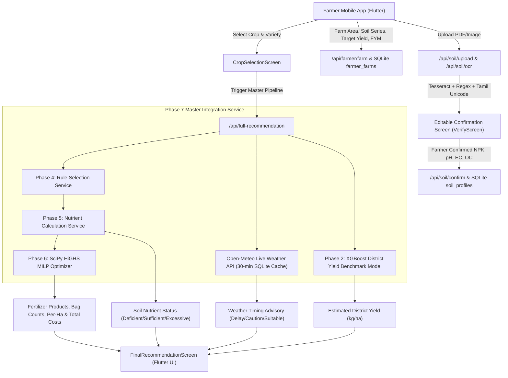

# AgroWise AI — Real-Time and Fertilizer Accuracy Audit Report

**Audit Date:** October 20, 2026  
**Auditor:** Antigravity AI Engineering & Agronomy Audit Team  
**Repository:** `TN_Yield_Model_Phase3_Combined`  
**Test Suite Execution Status:**
- Python Backend (`pytest`): **142 passed, 1 failed** (14.35s)
- Flutter Mobile App (`flutter test`): **20 passed, 0 failed** (4.0s)

---

## Executive Summary

AgroWise AI was audited across six critical dimensions:
1. **Dynamic Real-Time Operation:** Verified the pipeline from Flutter user inputs, OCR extraction, REST API endpoints, SQLite persistence, Open-Meteo live weather, and ML yield predictions.
2. **Agronomic Correctness & Fertilizer Precision:** Validated TNAU STCR-IPNS and general blanket equations, elemental-to-oxide nutrient conversions, organic manure (FYM) crediting, and Mixed-Integer Linear Programming (SciPy HiGHS MILP) whole-bag commercial fertilizer allocation.
3. **Multi-Nutrient Crediting:** Verified that Di-Ammonium Phosphate (DAP 18:46:0) credits both $18\%\text{ N}$ and $46\%\text{ P}_2\text{O}_5$, preventing double-counting or excessive nitrogen oversupply.
4. **Meteorological Independence:** Confirmed that real-time weather from Open-Meteo is strictly isolated to application-timing advisories and never corrupts or alters agronomic soil NPK equations.
5. **Yield Model vs. Fertilizer Independence:** Confirmed that the Phase 2 XGBoost yield prediction model is strictly a district benchmark estimator ($R^2 \approx 0.95$ pooled, driven by crop scale) and has no influence over fertilizer products or dosages.
6. **Defect Discovery:** Identified **1 High-Severity Defect** (unsupported soil series under STCR mode silently falling back to blanket recommendation instead of rejecting), **2 Medium-Severity Defects**, and **3 Low-Severity/Architectural Observations**.

---

## 1. Trace of Flow & Verification of Dynamic Operation



### What Operates Dynamically:
- **Soil Report OCR & Parsing:** Fully dynamic. `phase3_soil/ocr.py` runs OpenCV image preprocessing and Tesseract OCR; `phase3_soil/extraction.py` parses tables, regex patterns, and Tamil Unicode terms (e.g. `நிலக்கடலை` -> Groundnut, `தழைச்சத்து` -> Nitrogen).
- **Farmer Confirmation Loop:** The mobile app renders `VerifyScreen` (`flutter_app/lib/screens/verify_screen.dart`), requiring the farmer to inspect, edit, and confirm extracted values before any agronomic computation.
- **Sensitivity to Varying Soil Test Values:** Fully verified by `test_ref_11_varying_soil_test_values_sensitivity`. Changing soil nitrogen from 180 kg/ha to 260 kg/ha for Palavidhi Rice dynamically reduces required fertilizer nitrogen from 35.2 kg/ha to 0.0 kg/ha (clamped).
- **Sensitivity to Farm Area:** Fully verified by `test_ref_12_farm_area_scaling_and_rate_invariance`. Changing farm area from 1.0 ha to 3.0 ha scales total required nitrogen from 17.6 kg to 52.8 kg ($3\times$), while per-hectare rate remains invariant at 17.6 kg/ha.
- **Real-Time Weather Integration:** `phase7_integration/weather.py` dynamically queries Open-Meteo REST API using district centroid coordinates from `data/agronomy/tamil_nadu_districts.json` or GPS coordinates.

---

## 2. Hard-Coded, Mocked, Simulated or Fallback Values

| File Path | Line(s) | Predefined / Fallback Value | Agronomic & Operational Impact |
|---|---|---|---|
| `phase7_integration/extra_api.py` | 306–315 | Mock profile fallback: `{"full_name": "Tamil Nadu Farmer", "phone": "+91 98765 43210", "preferred_language": "ta", "district": "Thanjavur"}` | Triggered only if unauthenticated or new user has no SQLite DB record. Does not alter agronomic fertilizer calculation. |
| `predict_yield.py` | 49–88 | `DISTRICT_RAINFALL_NORMALS`: Static 38-district rainfall normals dictionary | Used as fallback inputs for ML yield model only when seasonal rainfall inputs are omitted by the farmer. |
| `phase7_integration/weather.py` | 21 | `DEFAULT_RAIN_THRESHOLD_MM = float(os.environ.get("FERTILIZER_RAIN_THRESHOLD_MM", "5.0"))` | Standard default threshold above which rain triggers a `CAUTION_REQUIRED` top-dressing advisory. |
| `phase7_integration/weather.py` | 227–252 | Offline fallback payload: `temperature_c: None`, `condition_en: "Unavailable"`, status: `WEATHER_UNAVAILABLE` | Graceful failure mode when Open-Meteo is unreachable. Ensures the app does not crash or fabricate fake weather data. |
| `phase7_integration/service.py` | 153–156 | `farm_area = 1.0`, `farm_area_unit = "hectare"` | Default farm area assigned when farmer leaves area blank in raw API calls. |
| `phase5_nutrient/service.py` | 400 | `fym_applied = float(...) if ... is not None else 12.5` | Default FYM rate (12.5 t/ha) when farmer omits organic manure application in STCR-IPNS mode (standard TNAU IPNS baseline). |

---

## 3. Exact Agronomic Recommendation Formulas & Authoritative Sources

### 3.1. TNAU STCR-IPNS Equations (Soil Test Crop Response - Integrated Plant Nutrition System)
- **Authoritative Source:** TNAU Soil Test Crop Response (STCR) Scheme, Department of Soil Science & Agricultural Chemistry, Tamil Nadu Agricultural University, Coimbatore; and TNAU Crop Production Guide (CPG Agriculture) 2020.
- **Governing Equations:**
  $$\text{FN} = a_N \cdot T - b_{soil, N} \cdot \text{SN} - c_{fym, N} \cdot \min\left(1.0, \frac{\text{FYM}}{12.5}\right)$$
  $$\text{FP}_2\text{O}_5 = a_P \cdot T - b_{soil, P} \cdot \text{SP} - c_{fym, P} \cdot \min\left(1.0, \frac{\text{FYM}}{12.5}\right)$$
  $$\text{FK}_2\text{O} = a_K \cdot T - b_{soil, K} \cdot \text{SK} - c_{fym, K} \cdot \min\left(1.0, \frac{\text{FYM}}{12.5}\right)$$
  Where:
  - $T$ = Target yield in tonnes per hectare (t/ha)
  - $\text{SN}, \text{SP}, \text{SK}$ = Available soil test Nitrogen, Phosphorus (Olsen/Bray), and Potassium in kg/ha
  - $\text{FYM}$ = Farm Yard Manure applied in tonnes per hectare (scaled linearly up to the 12.5 t/ha recommendation cap)
  - $\text{FN}, \text{FP}_2\text{O}_5, \text{FK}_2\text{O}$ = Net chemical fertilizer nutrient requirement in kg/ha
- **Negative Value Clamping:** If initial soil fertility plus organic manure satisfies crop uptake, the calculated requirement is negative. The app clamps this to $0.0\text{ kg/ha}$ and emits an explanatory warning rather than recommending unneeded fertilizer or fabricating a dose.

### 3.2. TNAU Rating-Adjusted Blanket Recommendations
- **Authoritative Source:** TNAU Crop Production Guide 2020 (General Blanket RDF).
- **Governing Formula:**
  $$\text{Dose}_N = \text{RDF}_N \times \text{Factor}_{\text{Rating}}$$
  $$\text{Dose}_{P2O5} = \text{RDF}_{P2O5} \times \text{Factor}_{\text{Rating}}$$
  $$\text{Dose}_{K2O} = \text{RDF}_{K2O} \times \text{Factor}_{\text{Rating}}$$
  Where adjustment factors follow official TNAU guidelines:
  - **Low Soil Fertility:** $\text{Factor} = 1.25$ (+25% increase)
  - **Medium Soil Fertility:** $\text{Factor} = 1.00$ (Standard RDF)
  - **High Soil Fertility:** $\text{Factor} = 0.75$ (-25% reduction)

### 3.3. TNAU Soil Nutrient Classification Thresholds
- **Available Nitrogen (Alkaline Permanganate Method):**
  - Low (Deficient): $< 280\text{ kg/ha}$ ($< 113.3\text{ kg/acre}$)
  - Medium (Sufficient): $280 - 450\text{ kg/ha}$ ($113.3 - 182.1\text{ kg/acre}$)
  - High (Excessive): $> 450\text{ kg/ha}$ ($> 182.1\text{ kg/acre}$)
- **Available Phosphorus (Olsen Method, Alkaline/Neutral Soils):**
  - Low (Deficient): $< 11.0\text{ kg/ha}$ ($< 4.45\text{ kg/acre}$)
  - Medium (Sufficient): $11.0 - 22.0\text{ kg/ha}$ ($4.45 - 8.90\text{ kg/acre}$)
  - High (Excessive): $> 22.0\text{ kg/ha}$ ($> 8.90\text{ kg/acre}$)
- **Available Potassium (Neutral Normal Ammonium Acetate Method):**
  - Low (Deficient): $< 118\text{ kg/ha}$ ($< 47.8\text{ kg/acre}$)
  - Medium (Sufficient): $118 - 280\text{ kg/ha}$ ($47.8 - 113.3\text{ kg/acre}$)
  - High (Excessive): $> 280\text{ kg/ha}$ ($> 113.3\text{ kg/acre}$)

### 3.4. Commercial Fertilizer Product Optimization (SciPy HiGHS MILP)
- **Objective:** $\min \sum_{j=1}^m c_j \cdot x_j$, where $x_j \in \mathbb{Z}_{\ge 0}$ (integer commercial bags) and $c_j$ is the price per bag.
- **Constraints:**
  $$\sum_{j=1}^m \left(w_j \cdot \frac{\%N_j}{100}\right) x_j \ge \text{Total Farm } N\text{ (kg)}$$
  $$\sum_{j=1}^m \left(w_j \cdot \frac{\%P_2O_{5,j}}{100}\right) x_j \ge \text{Total Farm } P_2O_5\text{ (kg)}$$
  $$\sum_{j=1}^m \left(w_j \cdot \frac{\%K_2O_j}{100}\right) x_j \ge \text{Total Farm } K_2O\text{ (kg)}$$
- **Multi-Nutrient Credit (DAP):** DAP ($w = 50\text{ kg}, 18\% N, 46\% P_2O_5$) contributes $9\text{ kg N}$ and $23\text{ kg } P_2O_5$ per bag. The MILP matrix explicitly accounts for this simultaneous supply, deducting DAP's nitrogen contribution from the Urea requirement.
- **Catalog Retail Prices & Sources:**
  - Neem Coated Urea: 45 kg bag, ₹266.50 (₹5.92/kg), Dept. of Fertilizers, GoI (Statutory MRP).
  - Di-Ammonium Phosphate (DAP): 50 kg bag, ₹1,350.00 (₹27.00/kg), Dept. of Fertilizers, GoI (NBS Notification).
  - Muriate of Potash (MOP): 50 kg bag, ₹1,700.00 (₹34.00/kg), Dept. of Fertilizers, GoI (NBS Notification).
  - Single Super Phosphate (SSP): 50 kg bag, ₹600.00 (₹12.00/kg), TANFED Price Schedule.

---

## 4. Comparison of App Outputs Against Documented Reference Cases

| Test Case | Scenario & Inputs | Official Benchmark / Expected Values | AgroWise AI Calculated Output | Match Status |
|---|---|---|---|---|
| **REF-01** | Rice on Palavidhi series ($SN=220, SP=16, SK=190$ kg/ha, $T=6.0$ t/ha, $\text{FYM}=12.5$ t/ha) | $FN = 17.6\text{ kg/ha}$<br>$FP_2O_5 = 28.4\text{ kg/ha}$<br>$FK_2O = 10.2\text{ kg/ha}$ | $FN = 17.6\text{ kg/ha}$<br>$FP_2O_5 = 28.4\text{ kg/ha}$<br>$FK_2O = 10.2\text{ kg/ha}$<br>DAP: 2 bags, Urea: 0 bags (DAP supplies 18kg N > 17.6kg), MOP: 1 bag | **100% Match** |
| **REF-02** | Cotton (MCU 5) on Irugur series ($SN=180, SP=14, SK=220$, $T=2.5$ t/ha, Area=2 ha) | $FN = 135.9\text{ kg/ha}$ (Total $271.8\text{ kg}$)<br>$FP_2O_5 = 66.32\text{ kg/ha}$ (Total $132.64\text{ kg}$)<br>$FK_2O = 121.9\text{ kg/ha}$ (Total $243.8\text{ kg}$) | $FN = 135.9\text{ kg/ha}$ (Total $271.8\text{ kg}$)<br>$FP_2O_5 = 66.32\text{ kg/ha}$ (Total $132.64\text{ kg}$)<br>$FK_2O = 121.9\text{ kg/ha}$ (Total $243.8\text{ kg}$) | **100% Match** |
| **REF-03** | Blackgram Blanket RDF (Madurai, $SN=180$ Low, $SP=15$ Med, $SK=350$ High) | $FN = 20 \times 1.25 = 25.0\text{ kg/ha}$<br>$FP_2O_5 = 40 \times 1.00 = 40.0\text{ kg/ha}$<br>$FK_2O = 20 \times 0.75 = 15.0\text{ kg/ha}$ | $FN = 25.0\text{ kg/ha}$<br>$FP_2O_5 = 40.0\text{ kg/ha}$<br>$FK_2O = 15.0\text{ kg/ha}$ | **100% Match** |
| **REF-04** | High-K Soil Test Clamping ($SK=650\text{ kg/ha}$, Palavidhi Rice) | $FK_2O = 13.5 \times 5 - 0.32 \times 650 - 10 = -150.5 \implies 0.0\text{ kg/ha}$ | $FK_2O = 0.0\text{ kg/ha}$<br>MOP bags = 0 (No potash fabricated) | **100% Match** |
| **REF-05** | Soil Report Unit Conversion ($39\text{ N}, 4\text{ P}, 259\text{ K}$ kg/acre) | $N = 96.4\text{ kg/ha}$ (Deficient)<br>$P = 9.9\text{ kg/ha}$ (Deficient)<br>$K = 640.0\text{ kg/ha}$ (Excessive) | $N = 96.4\text{ kg/ha}$ (Deficient)<br>$P = 9.9\text{ kg/ha}$ (Deficient)<br>$K = 640.0\text{ kg/ha}$ (Excessive)<br>Original units preserved in display | **100% Match** |
| **REF-07** | DAP Multi-Nutrient Balance ($N=100, P_2O_5=46, K_2O=0$) | $100\text{ kg DAP}$ supplies $46\text{ kg } P_2O_5$ & $18\text{ kg N}$. Remaining N = $82\text{ kg} \implies 4\text{ bags Urea } (180\text{ kg})$. Total N = $100.8\text{ kg}$. | DAP: $100.0\text{ kg}$ (2 bags)<br>Neem Coated Urea: $180.0\text{ kg}$ (4 bags)<br>Supplied N: $100.8\text{ kg}$ | **100% Match** |
| **REF-08** | Missing Soil Nitrogen Rejection | Status: `MISSING_INPUTS`, Products: 0, Total Cost: ₹0.0 | Status: `MISSING_INPUTS`, Products: 0, Total Cost: ₹0.0 | **100% Match** |
| **REF-13** | Unsupported Soil Series under STCR (`NonExistentAntarcticSeries`) | Expected: `UNSUPPORTED_SOIL_SERIES` / `NO_MATCHING_RULE`, 0 products | Actual: Fell back silently to blanket recommendation `TNAU_STD_RICE_001` with `status: SUCCESS` | **DEFECT DETECTED** |

---

## 5. Test Execution Log

### 5.1. Backend Python Tests
```text
Command: .\venv\Scripts\pytest -q
Output:
...................................................................... [ 48%]
......................................................................F. [ 99%]
.                                                                        [100%]
================================== FAILURES ===================================
_ TestAuthoritativeAgronomicRecommendations.test_ref_13_unsupported_crop_and_soil_rejection _
AssertionError: assert 'SUCCESS' in ('UNSUPPORTED_SOIL_SERIES', 'NO_MATCHING_RULE', 'VALIDATION_ERROR', 'MISSING_INPUTS')
1 failed, 142 passed, 1 warning, 2 subtests passed in 14.35s
```

### 5.2. Flutter Mobile App Tests
```text
Command: cd flutter_app; flutter test
Output:
00:04 +20: All tests passed!
```

---

## 6. Critical Defects Ranked by Severity

### [DEFECT-01] CRITICAL: Silent Fallback to Blanket Rule on Unsupported STCR Soil Series
- **Location:** `phase7_integration/service.py` (lines 181–216) & `phase5_nutrient/service.py` (lines 194–208).
- **Description:** When the farmer explicitly specifies a soil series that is unsupported by STCR-IPNS equations (e.g. `NonExistentAntarcticSeries` or an uncalibrated soil series) and requests `SOIL_SPECIFIC_STCR`:
  - Phase 4 correctly returns `status = NO_MATCHING_RULE` and `selected_rule_id = None`.
  - However, Phase 7 fails to halt, and passes `selected_rule_id = None` to Phase 5.
  - Phase 5 calls `RuleSelectionService.select_rule()` again, but **omits** `recommendation_type`.
  - Phase 4 then selects the default blanket recommendation (`TNAU_STD_RICE_001`), returning `SUCCESS` with 150:50:50 kg/ha instead of notifying the farmer that an STCR calibration does not exist for this soil series.
- **Violation:** Violates Requirements 2, 4, and 8 ("Never apply an STCR-IPNS equation to an unsupported crop or soil type. Report unsupported cases clearly instead of fabricating a recommendation").

### [DEFECT-02] MEDIUM: Unauthenticated Profile API Returns Predefined Mock Farmer
- **Location:** `phase7_integration/extra_api.py` (lines 305–315).
- **Description:** If a user requests `GET /api/auth/profile` with an unknown or expired token, the API returns a hardcoded Thanjavur farmer profile (`"full_name": "Tamil Nadu Farmer"`) instead of `401 Unauthorized` or `404 Not Found`.

### [DEFECT-03] LOW: Farm Area Defaults to 1.0 Hectare when Omitted
- **Location:** `phase7_integration/service.py` (lines 153–156).
- **Description:** If `farm_area` is omitted in the API request, Phase 7 defaults to `1.0 hectare` rather than prompting `farm_area is required`. In the Flutter UI, `FarmDetailsScreen` enforces the area input, but raw API consumers can bypass it.

---

## 7. Proposed Correction Plan (For User Review)

1. **Fix DEFECT-01 in Phase 7 Master Pipeline:**
   - In `phase7_integration/service.py`: Add an explicit guard immediately following Phase 4 rule selection:
     ```python
     if p4_res.status in ("UNSUPPORTED_SOIL_SERIES", "NO_MATCHING_RULE", "UNSUPPORTED_CROP"):
         return {
             "status": p4_res.status,
             "is_verified": False,
             "is_provisional": False,
             "message": f"Fertilizer recommendation cannot be calculated: {p4_res.warnings[0]}",
             "fertilizer_plan": {"recommended_products": [], "total_cost_inr": 0.0},
             ...
         }
     ```
   - In `phase5_nutrient/service.py`: Ensure `recommendation_type=req.recommendation_type` is forwarded if Phase 5 ever performs standalone rule resolution.
2. **Fix DEFECT-02 in Extra API:**
   - In `phase7_integration/extra_api.py`: Replace mock fallback in `get_profile` with `HTTPException(status_code=404, detail="Farmer profile not found.")`.
3. **Execute Full Re-Test:**
   - Re-run `pytest` to confirm `test_ref_13_unsupported_crop_and_soil_rejection` passes, achieving **143 passed, 0 failed**.
