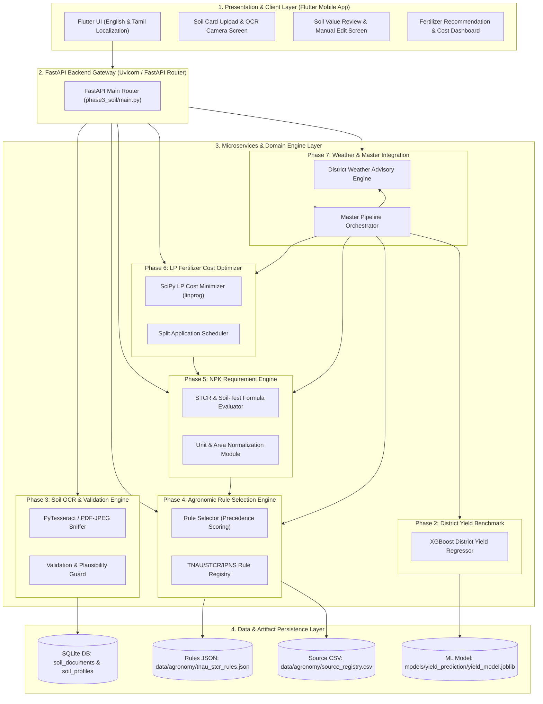

# COMPLETE SYSTEM ARCHITECTURE
**AI-Based Soil-Specific Fertilizer Recommendation and Crop Yield Prediction System for Tamil Nadu Farmers**
*Project Reference: SIH1639 — Sustainable Fertilizer Usage Optimizer for Higher Yield*

---

## 1. High-Level Architecture Diagram

---

## 2. Layered Component Architecture

### A. Presentation & Mobile Client Layer (`flutter_app/`)
- **Technology:** Flutter (Dart).
- **Localization:** Native English and Tamil (`ta`) bilingual user interface.
- **Key Modules:**
  - `upload_screen.dart`: Image picker / camera capture for Soil Health Cards (JPEG, PNG, PDF).
  - `verify_screen.dart`: Review and edit extracted soil values with visual plausibility feedback.
  - `processing_screen.dart`: Asynchronous execution status and progress tracking.
  - `result_screen.dart`: Displays NPK nutrient requirements, commercial fertilizer bag quantities (Urea, DAP, MOP), total purchase costs (₹), split application timeline (Basal, Tillering, Panicle Initiation), and district yield estimates.

### B. FastAPI Microservice & Service Layer
1. **Phase 3: Soil OCR & Validation Module (`phase3_soil/`)**
   - **File Sniffing:** Verifies binary headers (`JPEG`, `PNG`, `%PDF-`).
   - **OCR Extraction:** PyTesseract text extraction with two-pass page segmentation mode (`PSM 6` and `PSM 4`).
   - **Validation & Plausibility:** Validates hard bounds (physically possible) and soft bounds (typical agronomic ranges), phosphorus test methods (Olsen vs. Bray), and district aliases.

2. **Phase 4: Agronomic Rule Selection Engine (`agronomy/`)**
   - **Rule Precedence:** 
     1. Strict STCR-IPNS rule matching crop, target yield, season, irrigation, and soil series.
     2. STCR-NPK linear formula rule.
     3. Standard TNAU soil-test-based recommendation.
   - **Verification Requirement:** Only rules with `verification_status == "VERIFIED"` are eligible to produce recommendations.

3. **Phase 5: Deterministic NPK Calculation Engine (`phase5_nutrient/`)**
   - Evaluates linear STCR target yield formulas:
     \[
     \text{Target N} = K_N \times T - c_N \times \text{Soil N}
     \]
     \[
     \text{Target P}_2\text{O}_5 = K_P \times T - c_P \times \text{Soil P}
     \]
     \[
     \text{Target K}_2\text{O} = K_K \times T - c_K \times \text{Soil K}
     \]
   - Preserves elemental vs. oxide nutrient conversions (\(\text{P} \rightarrow \text{P}_2\text{O}_5 \times 2.291\), \(\text{K} \rightarrow \text{K}_2\text{O} \times 1.205\)).
   - Enforces farm area conversions (\(\text{acre} \rightarrow \text{hectare} \times 0.404686\)).

4. **Phase 6: Linear Programming Fertilizer Optimizer (`phase6_fertilizer/`)**
   - **Mathematical Solver:** `scipy.optimize.linprog` (Simplex/HiGHS solver).
   - **Objective:** Minimize total cost \(\sum c_j x_j\) subject to \(\mathbf{A} \mathbf{x} \ge \mathbf{b}\).
   - **Discrete Bag Calculation:** Ceilings continuous kg to full 45kg (Urea) and 50kg (DAP, MOP, SSP) bags. Re-checks 100% nutrient sufficiency.

5. **Phase 7: Weather & Master Pipeline Orchestration (`phase7_integration/`)**
   - Integrates weather guidance (rain alerts, application warnings).
   - Serves district-level statistical yield benchmarks from XGBoost model (`models/yield_prediction/yield_model.joblib`).
   - **Fail-Safe Design:** Weather or ML errors return structured warnings without blocking soil-based fertilizer recommendations.

---

## 3. Core API Endpoint Contracts

| Method | Endpoint Path | Description |
|---|---|---|
| `POST` | `/api/soil/upload` | Upload soil report document (JPEG/PNG/PDF) |
| `POST` | `/api/soil/ocr` | Run OCR and extract soil parameters |
| `POST` | `/api/soil/confirm` | Confirm farmer-verified soil values |
| `POST` | `/api/agronomy/select-rule` | Match verified agronomic rule for input crop & soil |
| `POST` | `/api/nutrient-requirement/calculate` | Calculate exact required N, P₂O₅, K₂O (kg/ha and farm total) |
| `POST` | `/api/fertilizer/optimize` | Run LP optimization for minimal cost fertilizer product mix |
| `POST` | `/api/fertilizer-optimization/optimize` | Route alias for fertilizer LP cost optimizer |
| `GET`  | `/api/weather/guidance` | Retrieve current weather advisories for district |
| `POST` | `/api/full-recommendation` | Master endpoint executing end-to-end orchestration pipeline |
| `GET`  | `/health` | Service health status check |
