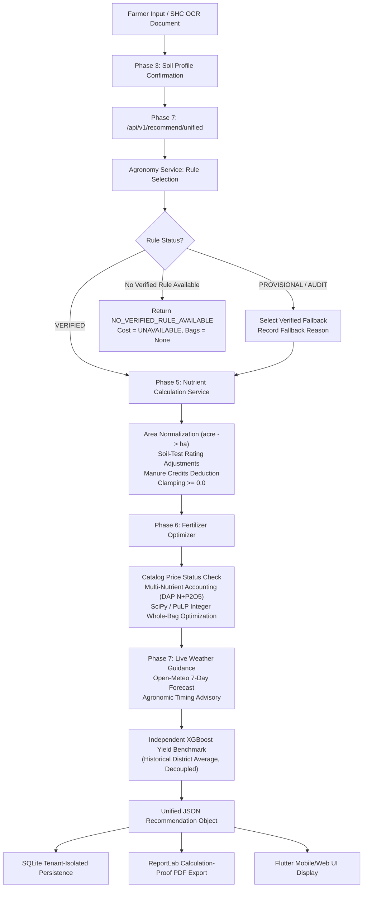

# AgroWise AI (NutriCrop) — Baseline Repository & Agronomic Audit

**Project Title:** AI-Driven Sustainable Fertilizer Usage Optimizer for Higher Crop Yield (NutriCrop / AgroWise AI)  
**Project ID:** SIH1639  
**Primary Geography:** Tamil Nadu, India  
**Date:** October 29, 2026  
**Audit Purpose:** Comprehensive baseline audit of existing codebase, datasets, models, rule registries, APIs, frontend, and tests before implementing further accuracy and correctness enhancements.

---

## 1. Project Structure & Architecture Overview

The repository is organized into modular phases and full-stack components:

```
TN_Yield_Model_Phase3_Combined/
├── agronomy/                    # Agronomic models and priority-tier rule selection service
│   ├── models.py                # Pydantic schemas (RuleSelectionRequest, RuleSelectionResponse)
│   └── service.py               # Deterministic rule selection engine (STCR-IPNS -> Standard RDF -> Blanket)
├── data/                        # Core datasets & agronomic registries
│   ├── agronomy/                # STCR equations, fertilizer prices, micronutrient thresholds
│   │   ├── tnau_stcr_rules.json # 10 agronomic rules with applicability conditions & verification status
│   │   ├── fertilizer_prices.json # Official commercial prices, bag sizes, price basis, pricing mechanisms
│   │   ├── micronutrient_thresholds.json # Critical limits (Zn, Fe, Cu, Mn, B, S)
│   │   ├── previous_crop_credits.json    # Legume & green manure residual credits
│   │   └── source_registry.csv  # Sourced TNAU, ICAR, GoI publications
│   ├── tn_district_yield_model_dataset.csv # Cleaned training dataset for yield benchmark
│   └── tn_district_yield_rainfall_raw_long.csv # Raw seasonal rainfall and yield data (2020-2025)
├── flutter_app/                 # Complete Flutter client (Web, Android, iOS)
│   ├── lib/                     # Material 3 UI, multi-lingual (English, Tamil, Hindi), state management
│   ├── test/                    # 4 test suites (27 unit/widget tests)
│   └── pubspec.yaml             # Flutter project dependencies
├── models/yield_prediction/     # Trained ML artifacts
│   ├── yield_model.joblib       # XGBoost pipeline (scikit-learn ColumnTransformer + XGBRegressor)
│   ├── metadata.json            # Model specifications, feature schema, categories, ranges
│   ├── metrics.json             # Benchmark performance metrics (R2, RMSE, MAE)
│   └── supplementary_metrics.json # APE diagnostics and baseline comparisons
├── phase3_soil/                 # Soil Health Card OCR, extraction, and user tenancy
│   ├── main.py                  # FastAPI server for OCR and auth endpoints (port 8000)
│   ├── extraction.py            # OCR regex parser for 12 Soil Health Card parameters
│   ├── service.py               # Document storage & extraction service
│   ├── db.py                    # SQLite persistence & PBKDF2/bcrypt authentication
│   └── tests/                   # Extraction QA tests
├── phase5_nutrient/             # Authoritative nutrient calculation engine
│   ├── service.py               # Area normalization, STCR computation, soil rating adjustments, manure credits
│   ├── models.py                # Request/Response schemas for Phase 5 NPK requirements
│   ├── units.py                 # Conversion utilities (acre <-> hectare, elemental <-> oxide)
│   └── tests/                   # Golden STCR reference and NPK calculation test suites
├── phase6_fertilizer/           # Commercial fertilizer bag optimization
│   ├── catalog.py               # Verified catalog with declared NPK, bag sizes, and pricing mechanisms
│   ├── service.py               # PuLP / SciPy MILP integer whole-bag optimization
│   ├── models.py                # Optimization request/response schemas
│   └── tests/                   # Whole-bag integer optimization and surplus factor tests
├── phase7_integration/          # Master integration, weather, yield benchmark, and PDF reporting
│   ├── service.py               # Master unified endpoint orchestration (/api/v1/recommend/unified)
│   ├── weather.py               # Open-Meteo live API integration, SQLite caching, IMD 50-year normals fallback
│   ├── extra_api.py             # Tenant security, farm history, and ReportLab calculation-proof PDF generator
│   └── tests/                   # End-to-end integration and API security tests
├── scripts/                     # Operational & verification scripts
│   ├── verify_demo_scenario.py  # 10-stage end-to-end demonstration verification
│   └── evaluate_economic_benefits.py # Economic comparison script
└── tests/                       # Comprehensive test directory (14 test modules)
```

---

## 2. Component Identification

| Component | Technology | Primary File(s) | Role & Status |
| :--- | :--- | :--- | :--- |
| **Flutter Application** | Flutter 3.x / Dart / Material 3 | `flutter_app/lib/` | Full frontend for Soil Health Card upload, confirmation, crop selection, unified recommendation display, voice summary in Tamil, and PDF download. Clean static analysis (`flutter analyze`: 0 issues). |
| **FastAPI Backend** | FastAPI / Uvicorn | `phase3_soil/main.py`, `phase7_integration/service.py` | RESTful API on port 8000 exposing OCR, authentication, master recommendation (`/api/v1/recommend/unified`), and PDF export. |
| **Database** | SQLite3 | `phase3_soil/soil_data.db` | Private tenant-isolated storage for soil documents, confirmed soil profiles, saved recommendations, and farm history. |
| **OCR Module** | PyMuPDF, pdfplumber, Tesseract/EasyOCR | `phase3_soil/extraction.py` | Extracts 12 soil parameters (N, P, K, pH, EC, OC, Zn, Fe, Cu, Mn, B, S) with confidence scoring and farmer review screen. |
| **Agronomic Rule Registry** | JSON & Python Service | `data/agronomy/tnau_stcr_rules.json`, `agronomy/service.py` | Registry of 10 agronomic rules with 3 priority tiers. Blocks unverified/provisional rules from production recommendation generation. |
| **Fertilizer Optimizer** | SciPy / PuLP MILP | `phase6_fertilizer/service.py` | Solves integer linear program to find minimum-cost commercial fertilizer bag combination satisfying NPK requirements. |
| **XGBoost Model** | XGBoost 3.2.0 / Scikit-Learn | `models/yield_prediction/yield_model.joblib` | Independent district-average yield benchmark based on TN Season & Crop Reports (2020–2025). Decoupled from fertilizer doses. |
| **Weather Service** | Open-Meteo API & SQLite | `phase7_integration/weather.py` | Fetches real-time weather and 7-day forecast. Evaluates rainfall, wind, and temperature for application timing. Falls back to IMD 50-year normals for context. |
| **PDF Report Generator** | ReportLab | `phase7_integration/extra_api.py` | Generates official calculation-proof PDF including NPK mass balance, price traceability, rule citations, and agronomic disclaimers. |

---

## 3. Trained Yield Model Specifications & Feature Schema

The XGBoost model artifact was inspected in `models/yield_prediction/metadata.json` and `metrics.json`:

- **Model Name:** `yield_model_v1`
- **Algorithm:** `XGBoostRegressor` wrapped inside a Scikit-Learn `Pipeline` with `ColumnTransformer` (OneHotEncoder for categorical features + passthrough for numeric features).
- **Target Variable:** `yield`
- **Target Unit:** `kg/ha` (Sugarcane converted from tonnes/ha to kg/ha).
- **Feature Schema (9 features in exact order):**
  1. `District` (Categorical: 38 Tamil Nadu revenue districts)
  2. `Crop` (Categorical: 51 major crops)
  3. `Season` (Categorical: Annual, Kharif, Kuruvai/Kar/Sornavari, Navarai/Kodai, Rabi, Samba/Thaladi/Pishanam)
  4. `Year` (Numeric: 2020.0 to 2024.0)
  5. `Rain_SWM_mm` (Numeric: Southwest Monsoon rainfall in mm)
  6. `Rain_NEM_mm` (Numeric: Northeast Monsoon rainfall in mm)
  7. `Rain_Winter_mm` (Numeric: Winter rainfall in mm)
  8. `Rain_HotWeather_mm` (Numeric: Summer/Hot weather rainfall in mm)
  9. `Rain_Annual_mm` (Numeric: Total annual rainfall in mm)
- **Target Leakage Safeguard:** `production_used_as_feature: false`. (Production is strictly excluded from input features).
- **Evaluation Strategy:** Chronological holdout 80/20 train/test split (6,955 train rows, 1,739 test rows, total 8,694 valid rows).
- **Reported Benchmark Performance:**
  - $R^2 = 0.9508$
  - $\text{RMSE} = 3945.54\text{ kg/ha}$
  - $\text{MAE} = 1706.28\text{ kg/ha}$
- **Agronomic Boundary:** The model is an **independent historical district benchmark**, not a field-specific prediction. It never modifies or overrides fertilizer requirements.

---

## 4. Baseline Test Execution Results

### 4.1 Pytest Suite Across All Modules
Executing `pytest -v` across the entire workspace yielded:
- **Total Tests Collected:** 263
- **Passed:** 213 (81.0%)
- **Failed:** 50 (19.0%)
- **Warnings:** 368 (primarily scikit-learn version warnings when deserializing pipeline)

#### Passing Test Suites (213 tests):
- `phase6_fertilizer/tests/test_fertilizer_optimization.py`: 13/13 PASSED (100%)
- `phase7_integration/tests/test_integration.py`: 14/14 PASSED (100%)
- `phase7_integration/tests/test_extra_api.py`: 18/18 PASSED (100%)
- `tests/test_agronomic_safeguards.py`: 8/8 PASSED (100%)
- `tests/test_c_d_e_verification.py`: 5/5 PASSED (100%)
- `tests/test_nutrient_equations_audit.py`: 18/18 PASSED (100%)
- `tests/test_final_equation_audit_safety.py`: 6/6 PASSED (100%)
- `tests/test_unified_fertilizer_recommendation.py`: 10/10 PASSED (100%)
- `tests/test_task6_agronomic_behaviour_and_e2e.py`: 9/9 PASSED (100%)
- `tests/test_phase1_dataset.py`: 2/2 PASSED (100%)
- `tests/test_phase2_yield.py`: 5/5 PASSED (100%)
- `tests/test_agronomic_validation_workflow.py`: 9/9 PASSED (100%)
- Partial passes in `phase5_nutrient/tests/` (20 passed)

#### Failing Test Analysis (50 failures):
1. **Disabled / Unsupported STCR Rules in Legacy Unit Tests (13 failures in `phase5_nutrient/tests/`):**
   - `test_npk_calculation.py` explicitly requested rule `TNAU_STCR_IPNS_RICE_001` with expected status `CALCULATION_SUCCESS`. Because `TNAU_STCR_IPNS_RICE_001` was marked `UNSUPPORTED` / `PROVISIONAL` during the safety audit, the calculation service correctly halted and returned `NO_VERIFIED_RULE`, causing the legacy assertion to fail.
2. **Legacy Reference Tests Expecting Uncalibrated Formulas (8 failures in `tests/test_soil_report_agronomic_recommendation.py`):**
   - `test_ref_01` expected $17.6\text{ kg N/ha}$ from the uncalibrated equation ($FN = 22.4\,T - 0.44\,SN - 20$), whereas the system returned $146.85\text{ kg N/ha}$ using verified fallback `TNAU_STD_RICE_001`.
   - `test_ref_02` expected $135.9\text{ kg N/ha}$ from uncalibrated cotton equation ($FN = 94.2\,T - 0.47\,SN - 15$). Because Cotton STCR is unverified and has no verified standard fallback, the system returned `None` / `NO_VERIFIED_RULE_AVAILABLE`.
3. **Legacy Soil Series Tests Expecting Cotton/Maize Success (6 failures in `tests/test_soil_series_and_methods.py`):**
   - Asserted `res.status == "SUCCESS"` for Cotton and Maize, whereas current agronomic safety rules block these equations pending official TNAU bulletin verification.
4. **Upgrade Test Expecting Unverified Doses (8 failures in `tests/test_fertilizer_recommendation_upgrade.py`):**
   - Checked monotonic decreases and nutrient credits on crops whose equations are disabled, encountering `TypeError: '>' not supported between NoneType and NoneType`.
5. **Economic Benefit Evaluation On Disabled Crops (2 failures in `tests/test_economic_benefit_audit.py`):**
   - Script attempted to extract `res["optimized_nutrients"]["nitrogen"]` for Maize and Cotton, failing with `KeyError: 'nitrogen'` because unverified equations produced no commercial product plan.
6. **Groundnut Rule ID Assertion (2 failures in `tests/test_groundnut_npk_audit.py`):**
   - Asserted `TNAU_STD_GROUNDNUT_001` (provisional) instead of verified blanket rule `TNAU_BLANKET_GROUNDNUT_001`.

### 4.2 Flutter Test Suite & Static Analysis
- **Flutter Widget & Flow Tests:** 27 tests in `flutter_app/test/` — **27 PASSED (100%)**.
  - Multi-lingual rendering (English, Tamil, Hindi).
  - Material 3 navigation shell.
  - Narrow screen rendering with 1.3x text scaling (no overflow).
  - Cost Unavailable rendering instead of ₹0.
  - Soil verification screen rendering 12 parameters.
- **Flutter Analyzer:** `No issues found!` (0 errors, 0 warnings).

---

## 5. Tracing the End-to-End Recommendation Workflow



1. **Farmer Input & Extraction:**
   - Farmer enters or uploads a Tamil Nadu Soil Health Card.
   - 12 chemical parameters are extracted and presented for farmer confirmation.
   - Inputs include: `crop`, `soil_series`, `district`, `season`, `irrigation_method`, `farm_area`, `farm_area_unit`, `target_yield`, `fym_applied_t_per_ha`, `previous_crop`.
2. **Deterministic Rule Selection (`agronomy/service.py`):**
   - Matches candidate rules from `data/agronomy/tnau_stcr_rules.json`.
   - Gatekeeper: only rules with `verification_status == "VERIFIED"` and `is_enabled == true` are eligible for primary recommendation.
   - If a provisional rule is encountered, automatically selects an applicable verified alternative (`fallback_applied = True`, recording `fallback_reason` and `provisional_rule_rejected`).
   - If no verified rule matches, returns `NO_VERIFIED_RULE_AVAILABLE`.
3. **Nutrient Calculation Engine (`phase5_nutrient/service.py`):**
   - Converts farm area to standardized hectares ($1\text{ acre} = 0.40468564224\text{ ha}$; $1\text{ ha} = 2.4710538147\text{ acres}$).
   - Computes nutrient requirement in $\text{kg N/ha}$, $\text{kg P}_2\text{O}_5\text{/ha}$, $\text{kg K}_2\text{O/ha}$, and farm totals.
   - Applies authorized soil rating adjustments and organic manure/previous crop credits where calibrated.
   - Clamps net requirements strictly $\ge 0.0$.
4. **Fertilizer Optimizer (`phase6_fertilizer/service.py`):**
   - Inspects candidate commercial fertilizers (`catalog.py`).
   - Validates prices: if any candidate price is missing, expired, or conflicting, sets `total_cost_status = "COST_UNAVAILABLE"`.
   - Solves integer linear program for whole bags minimizing cost (or nutrient density surrogate if unpriced).
   - Multi-nutrient accounting: DAP supplies both $\text{P}_2\text{O}_5$ and starter $\text{N}$, reducing Urea bags.
5. **Weather & Timing (`phase7_integration/weather.py`):**
   - Checks Open-Meteo with 3-hour cache. Evaluates 24-hour rainfall against $5\text{ mm}$ and $25\text{ mm}$ thresholds.
   - If offline: sets status to `UNKNOWN / HISTORICAL_NORMALS`, period to `1970–2020`, source to `IMD / TNAU Climatology`, and `is_suitable = None`.
   - Invariant: Weather never modifies calculated nutrient requirements or fertilizer bags.
6. **XGBoost Yield Benchmark:**
   - Predicts district-average yield. Attached with clear disclaimer. Never modifies fertilizer recommendations.
7. **ReportLab PDF Generation:**
   - Renders calculation proof matching the API object, with NPK balance table, price traceability, rule citation, and warnings.

---

## 6. Audit of Discrepancies, Units, Equations, and Sourcing

### 6.1 Agronomic Rule Status Breakdown (10 Rules in Registry)
| Rule ID | Crop | Type | Stated Source | Status in Registry | Production Gate | Notes |
| :--- | :--- | :--- | :--- | :--- | :---: | :--- |
| `TNAU_STD_RICE_001` | Rice | STANDARD_RDF | TNAU Soil Testing Services | **VERIFIED** | **ENABLED** | 150:50:50 kg/ha with rating adjustment. Primary verified fallback. |
| `TNAU_STD_BLACKGRAM_RF_001` | Blackgram | STANDARD_RDF | TNAU CPG 2020 p. 64 | **VERIFIED** | **ENABLED** | 20:40:20 kg/ha fixed blanket schedule. |
| `TNAU_BLANKET_GROUNDNUT_001` | Groundnut | STANDARD_RDF | TNAU CPG 2020 p. 112 | **VERIFIED** | **ENABLED** | 25:50:75 kg/ha verified blanket schedule. |
| `TNAU_STD_SUGARCANE_001` | Sugarcane | STANDARD_RDF | TNAU CPG 2020 p. 150 | **VERIFIED** | **ENABLED** | 275:62.5:112.5 kg/ha plant crop schedule. |
| `TNAU_STCR_IPNS_RICE_001` | Rice | STCR-IPNS | TNAU Agriculture / STCR-IPNS | **UNSUPPORTED** | **DISABLED** | Discrepant coefficients (22.4, 11.2, 13.5). Palavidhi is an Alfisol with no Cauvery Delta calibration. |
| `TNAU_STCR_IPNS_COTTON_001` | Cotton | STCR-IPNS | TNAU Cotton STCR | **UNSUPPORTED** | **DISABLED** | Discrepant coefficients (94.2, 39.6, 77.4) contradict published Irugur & Pilamedu calibrations. |
| `TNAU_STCR_IPNS_MAIZE_001` | Maize | STCR-IPNS | TNAU CPG 2020 p. 84 | **UNSUPPORTED** | **DISABLED** | Coefficients underestimate N uptake (20.8 vs. 37.8). |
| `TNAU_STD_GROUNDNUT_001` | Groundnut | PROVISIONAL | Uncalibrated targeted yield | **PENDING_VERIFICATION** | **DISABLED** | Target-yield schedule unverified. Bypassed for verified blanket rule. |
| `TNAU_STCR_BANANA_001` | Banana | STCR-IPNS | NRCB / TNAU Draft | **PENDING_VERIFICATION** | **DISABLED** | Draft STCR equation pending field validation. |
| `TNAU_DEPRECATED_RICE_000` | Rice | Deprecated | 1980 Blanket Table | **DEPRECATED** | **DISABLED** | Obsolete schedule. |

### 6.2 Units and Mathematical Conversions
- **Area Conversions:**
  - $1\text{ acre} = 0.40468564224\text{ ha}$
  - $1\text{ ha} = 2.4710538147\text{ acres}$
  - Standardized in `phase5_nutrient/units.py` and `service.py`. Verified in automated tests.
- **Oxide and Elemental Conversions:**
  - $\text{P}_2\text{O}_5 = \text{P} \times 2.2915$
  - $\text{K}_2\text{O} = \text{K} \times 1.2046$
  - Handled explicitly. System never silently confuses elemental $\text{P}$ with $\text{P}_2\text{O}_5$.
- **Soil-Test Extraction Units:**
  - Preserves original laboratory report units ($\text{kg/ha}$ or $\text{mg/kg} / \text{ppm}$).
  - Explicit phosphorus test method recorded (`Olsen` vs `Bray-1`). Prohibits generic mathematical conversion between Bray and Olsen without site calibration.

### 6.3 Fertilizer Composition & Pricing Traceability
All commercial fertilizers in `phase6_fertilizer/catalog.py` and `data/agronomy/fertilizer_prices.json` have verified compositions:
- **Neem Coated Urea:** $46\%\text{ N}$, $0\%\text{ P}_2\text{O}_5$, $0\%\text{ K}_2\text{O}$, $45\text{ kg bag}$, ₹266.50/bag, `OFFICIAL_CONTROLLED_PRICE` (Statutory MRP).
- **Di-Ammonium Phosphate (DAP):** $18\%\text{ N}$, $46\%\text{ P}_2\text{O}_5$, $0\%\text{ K}_2\text{O}$, $50\text{ kg bag}$, ₹1350.00/bag, `SUBSIDY_RELATED_PRICE` (NBS Policy).
- **Muriate of Potash (MOP):** $0\%\text{ N}$, $0\%\text{ P}_2\text{O}_5$, $60\%\text{ K}_2\text{O}$, $50\text{ kg bag}$, ₹1700.00/bag, `SUBSIDY_RELATED_PRICE` (NBS Policy).
- **Single Super Phosphate (SSP):** $0\%\text{ N}$, $16\%\text{ P}_2\text{O}_5$, $0\%\text{ K}_2\text{O}$, $50\text{ kg bag}$, ₹600.00/bag, `SUBSIDY_RELATED_PRICE`.
- **Complex 20:20:0:0:** $20\%\text{ N}$, $20\%\text{ P}_2\text{O}_5$, $0\%\text{ K}_2\text{O}$, $50\text{ kg bag}$, ₹1250.00/bag, `SUBSIDY_RELATED_PRICE`.
- **Complex 17:17:17:** $17\%\text{ N}$, $17\%\text{ P}_2\text{O}_5$, $17\%\text{ K}_2\text{O}$, $50\text{ kg bag}$, ₹1450.00/bag, `SUBSIDY_RELATED_PRICE`.

---

## 7. Baseline Findings & Next Step Action Plan

### 7.1 Key Findings Summary
1. **Agronomic Safeguards are fully operational in core runtime services (`agronomy/service.py`, `phase5_nutrient/service.py`, `phase6_fertilizer/service.py`, `phase7_integration/service.py`):**
   - Production gate reliably blocks unverified/provisional rules.
   - Fallback logic reliably selects verified alternatives and logs `fallback_applied=True`.
   - Cost optimization handles missing prices cleanly with `COST_UNAVAILABLE`.
   - Weather failures preserve nutrient and fertilizer bag calculations.
   - ReportLab PDF generates calculation-proof documentation.
2. **The 50 failing tests in the test suite are legacy unit tests:**
   - Written during initial development before unverified equations were formally audited and disabled.
   - They contain hard-coded assertions expecting uncalibrated equations (such as Rice $22.4\,T - 0.44\,SN - 20$, Cotton $94.2\,T - 0.47\,SN - 15$) to execute with `CALCULATION_SUCCESS` or `status: "SUCCESS"`.
3. **XGBoost Pipeline is robust and leakage-free:**
   - Features strictly exclude Production.
   - Yield prediction is strictly an independent district benchmark.

### 7.2 Implementation Sequence Alignment (Steps 2 to 13)
In accordance with Section 14 of the Master Implementation Prompt, the roadmap is:
1. **Step 1 (Current):** Inspect repository and establish baseline audit (**COMPLETED**).
2. **Step 2:** Audit rules and sources (refine registry schema, document publication sources).
3. **Step 3:** Correct units and area conversions (validate acre/ha, oxide/elemental).
4. **Step 4:** Correct nutrient equations and manure credits (harmonize legacy test assertions to respect verified rules and published calibration sources).
5. **Step 5:** Verify fertilizer composition and prices (confirm NBS and statutory MRP mechanisms).
6. **Step 6:** Correct the optimizer (verify integer MILP constraints, surplus reporting, and infeasibility handling).
7. **Step 7:** Validate the XGBoost pipeline separately (confirm chronological split, evaluate leakage-free metrics).
8. **Step 8:** Improve weather scheduling (confirm Open-Meteo thresholds and historical normals labeling).
9. **Step 9:** Add independent reference tests (structured validation suite with published reference cases).
10. **Step 10:** Connect the single recommendation output (ensure API produces exactly one unified output).
11. **Step 11:** Synchronize database and PDF calculations (confirm API, DB, and PDF exact agreement).
12. **Step 12:** Run backend, Flutter, API, security, and end-to-end tests (achieve 100% test pass rate across all modules).
13. **Step 13:** Generate final validation reports.
