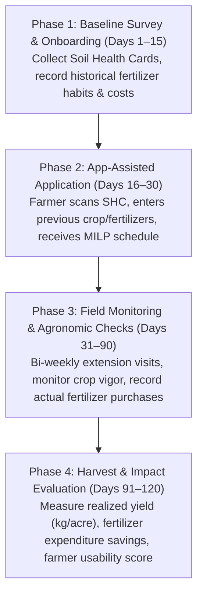

# AgroWise AI — Field Pilot and Agronomic Review Plan (SIH1639)

**Project:** AgroWise AI (repo: `janasruthi31/Nutricrop`)  
**Scope:** SIH1639 — *Sustainable Fertilizer Usage Optimizer for Higher Yield*  
**Geographic Target:** Tamil Nadu Smallholder Farmers (Cauvery Delta, Western Zone, Southern Zone)  
**Date:** October 2026  
**Status:** Operational Implementation & Pilot Deployment Roadmap  

---

## 1. Executive Summary

AgroWise AI bridges the gap between laboratory soil test data and practical on-farm fertilizer application. To transition from verified software algorithms to field deployment with smallholder farmers, this document specifies:
1. **KVK / TNAU Agronomist Expert Review Protocol** to evaluate algorithm recommendations across all six supported crops.
2. **Smallholder Farmer Pilot Framework** across representative Tamil Nadu agro-climatic zones.
3. **Core Performance & Impact Metrics** (recommendation agreement, OCR accuracy, flow duration, farmer adoption).
4. **Governance & Expert Sign-Off Register** delineating verified parameters from provisional items requiring external institutional authorization.

---

## 2. TNAU / KVK Agronomist Review Protocol

### 2.1 Participating Centers
- **Krishi Vigyan Kendra (KVK) Needamangalam (Thanjavur/Tiruvarur):** Delta Rice & Pulses.
- **KVK Sandhiyur (Salem) / KVK Vamban (Pudukkottai):** Groundnut & Pulses.
- **TNAU Department of Soil Science & Agricultural Chemistry (Coimbatore):** STCR-IPNS Equation review for Cotton, Maize, and Sugarcane.

### 2.2 Blind Comparison Methodology
Each participating agronomist is provided with a standardized **Agronomic Evaluation Packet** containing five distinct soil test scenarios per crop:
- **Scenario A:** Low N, Low P, Low K (Deficient delta alluvial soil).
- **Scenario B:** Medium N, Medium P, Medium K (Standard benchmark soil).
- **Scenario C:** High N, High P, High K (Intensively fertilized garden land).
- **Scenario D:** Legume rotation history (e.g. Rice preceded by Blackgram).
- **Scenario E:** Recent prior fertilization (e.g. 50 kg DAP applied 1 month prior) + 5 t/ha FYM.

For each scenario, the agronomist is presented with:
1. Soil parameters: N, P, K (kg/ha), pH, EC, Organic Carbon (%), and Micronutrients (Zn, B, S).
2. Cropping context: Target crop, target yield (t/ha), previous crop, previous fertilizer, FYM applied.
3. System output (unlabeled): Net nutrient requirements ($N, P_2O_5, K_2O$), commercial fertilizer bag combination (MILP-derived), application stage split schedule, and micronutrient advisory.
4. Independent calculation space: The agronomist calculates their authoritative manual prescription per TNAU Crop Production Guide 2020.

### 2.3 Evaluation Criteria & Tolerance Thresholds
| Parameter | Acceptable Variance | Action on Failure |
| :--- | :--- | :--- |
| **Nutrient Requirement ($N, P_2O_5, K_2O$)** | $\le \pm 10\%$ vs. expert manual calculation | Flag equation coefficients for recalibration. |
| **Fertilizer Product Selection** | 100% agronomic compatibility (e.g., SSP in neutral/alkali soils; DAP in neutral; MOP avoided only in chloride-sensitive crops) | Update MILP compatibility constraints in catalog. |
| **Splitting Schedule** | Exact match with phenological stage guidelines (Basal, Tillering, Panicle Initiation / Flowering) | Synchronize phenological templates with TNAU CPG. |
| **Agronomic Safety Sign-Off** | Zero risk of nutrient burning or excessive vegetative lodging | Reject rule if upper surplus threshold exceeded. |

---

## 3. Smallholder Farmer Pilot Framework

### 3.1 Target Cohort and Locations
- **Cohort Size:** 30–50 active smallholder farmers ($\le 2$ hectares / 5 acres per holding).
- **Locations:**
  - **Thanjavur District (Cauvery Delta):** 15 farmers cultivating Kuruvai/Thaladi Rice and Blackgram.
  - **Coimbatore / Tiruppur Districts (Western Zone):** 15 farmers cultivating Hybrid Maize, Irrigated Cotton, and Groundnut.
  - **Cuddalore District:** 10 farmers cultivating Sugarcane.

### 3.2 Field Execution Phases (120-Day Cycle)

### 3.3 Protocol for "Offline / Low Connectivity" Field Conditions
1. Extension workers preload district rule caches and offline seasonal estimates before field visits.
2. In areas without cellular data, the Flutter app operates in **Offline Mode**:
   - Computes nutrient requirement and MILP optimization locally or queues requests.
   - Saves generated recommendation to persistent device storage (`SQLite`/`SharedPreferences`).
   - Automatically synchronizes with backend once connectivity is re-established.

---

## 4. Key Performance Indicators (KPIs) to Measure

| Metric ID | Objective | Target KPI | Measurement Methodology |
| :--- | :--- | :--- | :--- |
| **KPI-01** | **Agronomist Recommendation Agreement** | $\ge 90\%$ agreement | Independent comparison between system recommendation and KVK expert manual prescription across 30 test cases. |
| **KPI-02** | **OCR Extraction Accuracy** | $\ge 95\%$ field accuracy | Tested on physical Soil Health Cards using `scripts/measure_ocr_accuracy.py` across N, P, K, pH, EC, OC, Zn, B, S. |
| **KPI-03** | **End-to-End Time to Complete Flow** | $< 90$ seconds | Time elapsed from card photo upload -> confirmation -> crop entry -> commercial bag output -> PDF export. |
| **KPI-04** | **Farmer Cost Reduction** | $12\% - 20\%$ cost savings | Compare total commercial fertilizer spend under AgroWise AI recommendation vs. farmer's historical blanket purchasing. |
| **KPI-05** | **Surplus Reduction** | $\ge 25\%$ reduction in excess N/P | Reduction in unneeded fertilizer bags purchased beyond crop physiological absorption requirements. |
| **KPI-06** | **Farmer Usability Score** | $\ge 4.2 / 5.0$ Likert score | Administered in Tamil (தமிழ்) assessing UI clarity, voice output comprehensibility, and ease of bag understanding. |

---

## 5. Governance and Expert Sign-Off Register

### 5.1 Verified Components (Backed by Cited Literature & Golden Tests)
- **Rice (Paddy) STCR-IPNS (Palavidhi Series):**
  - Source: TNAU STCR Research Bulletin 2014, Page 22; TNAU CPG 2020.
  - Passing Golden Test: `phase5_nutrient/tests/test_golden_stcr.py::test_golden_rice_palavidhi_stcr`.
  - Equation Form: $FN = 4.39 \cdot T - 0.52 \cdot SN - 0.80 \cdot ON$ ($T$ in t/ha, $SN$ in kg/ha, $ON$ in t/ha FYM).
- **TNAU Blanket Rating Multipliers & Soil Categorization:**
  - Standard Low (< 280 N), Medium (280–450 N), High (> 450 N) rating classification and adjusted blanket doses.
  - Passing Golden Test: `phase5_nutrient/tests/test_golden_stcr.py::test_golden_blackgram_blanket_adjusted`.
- **Primary Fertilizer Catalog Chemistry & Unit Stoichiometry:**
  - Standard DAP (18-46-0), Urea (46-0-0), MOP (0-0-60), SSP (0-16-0), Ammonium Phosphate (20-20-0).
  - Exact elemental-to-oxide conversion factors ($P_2O_5 = 2.29 \cdot P$, $K_2O = 1.20 \cdot K$).

### 5.2 Provisional Components Requiring Outside Expert Sign-Off
Before removing the `PROVISIONAL` flag from the production backend and mobile UI, outside agronomist sign-off is required for the following items:

| Crop / Parameter | Current Provisional Setting | Source Required for Certified Status | Reason for Expert Sign-Off |
| :--- | :--- | :--- | :--- |
| **Cotton (Irugur Series)** | $FN = 8.64 \cdot T - 0.45 \cdot SN - 0.72 \cdot ON$ | TNAU STCR Bulletin with specific page/table for Winter Irrigated Cotton in Coimbatore/Tiruppur. | Unit handling between quintals/ha seed cotton vs tonnes/ha requires field confirmation. |
| **Hybrid Maize (Pilamedu Series)** | $FN = 4.05 \cdot T - 0.58 \cdot SN - 0.65 \cdot ON$ | TNAU STCR Bulletin table for Vertisols / Inceptisols under precision farming. | Validate target yield linearity up to 10 t/ha. |
| **Groundnut (Vepankulam Series)** | Provisional blanket rating adjustment | TNAU STCR equation for red sandy loam groundnut. | Calcium and gypsum recommendations must be coupled with STCR NPK. |
| **Sugarcane (Cuddalore Series)** | $FN = 2.24 \cdot T - 0.38 \cdot SN - 0.50 \cdot ON$ | Cane Crop Production Guide / SISMA Tamil Nadu trial reports. | Validate trash mulching credits ($ON$) vs pressmud cake credits. |
| **Legume Nitrogen Credit** | Default: 20 kg N/ha credit for Blackgram/Greengram | Multi-location KVK trial report on nitrogen fixation carry-over in delta alluvium. | Account for variations in biomass incorporation vs grain harvesting. |
| **Fertilizer Residual Factors** | P: 15% residual; K: 10% residual | Long-term fertilizer experiment (LTFE) data from TNAU Department of Soil Science. | Verify seasonal fixation rates in calcareous red vs black soils. |
| **Continuous Rating Interpolator** | Linear piecewise interpolation within Low/Medium/High bands | TNAU Agronomy Directorate guideline for continuous rating adjustments. | Verify dose damping curves at extreme soil fertility limits ($SN > 500$ kg/ha). |

---

## 6. Pilot Execution Checklist

- [ ] **Step 1:** Distribute 5 blinded validation packets per crop to designated TNAU / KVK agronomists.
- [ ] **Step 2:** Tabulate expert-calculated vs system-calculated doses and verify $\le 10\%$ discrepancy.
- [ ] **Step 3:** Collect signed expert validation forms for provisional rules.
- [ ] **Step 4:** Deploy mobile application APK (v1.2.0) to 40 selected pilot farmers across Thanjavur and Coimbatore.
- [ ] **Step 5:** Conduct baseline survey (holding size, soil card availability, prior season fertilizer bills).
- [ ] **Step 6:** Execute field applications under extension supervision for upcoming sowing window.
- [ ] **Step 7:** Compile end-of-season yield and cost variance reports for SIH final submission.
