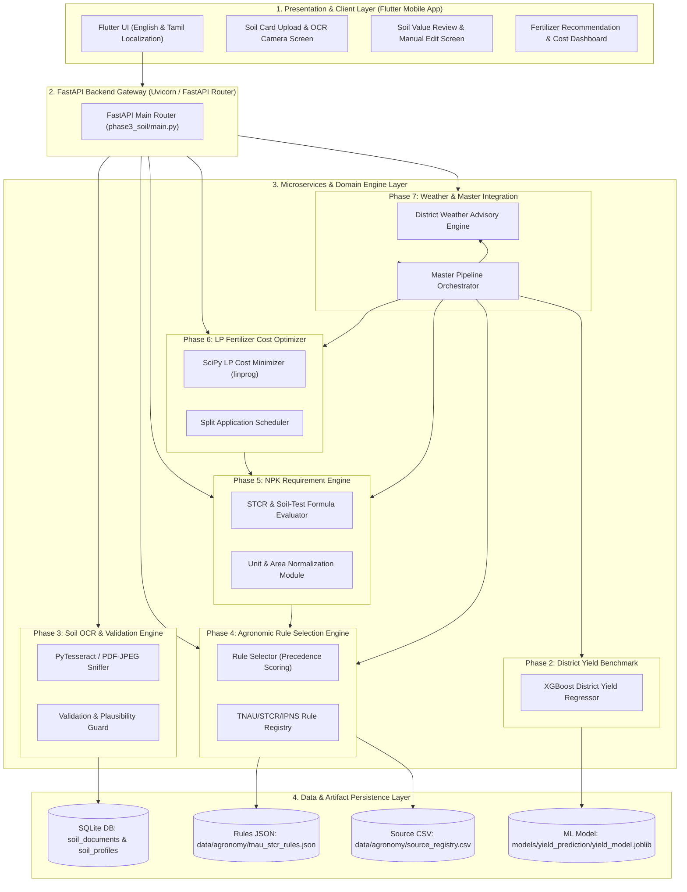

# COMPLETE SYSTEM ARCHITECTURE
**AI-Based Soil-Specific Fertilizer Recommendation and Crop Yield Prediction System for Tamil Nadu Farmers**
*Project Reference: SIH1639 — Sustainable Fertilizer Usage Optimizer for Higher Yield*

---

## 1. High-Level Architecture Diagram



---

## 2. Layered Component Architecture

### A. Presentation & Mobile Client Layer (`flutter_app/`)
- **Technology:** Flutter (Dart).
- **Localization:** Native English and Tamil (`ta`) bilingual user interface.
- **Key Modules:**
  - `upload_screen.dart`: Image picker / camera capture for Soil Health Cards (JPEG, PNG, PDF).
  - `verify_screen.dart`: Review and edit extracted soil values with visual plausibility feedback.
  - `processing_screen.dart`: Asynchronous execution status and progress tracking.
  - `result_screen.dart`: Displays NPK nutrient requirements, commercial fertilizer bag quantities (Urea, DAP, MOP), total purchase costs (₹), split application timeline (Basal, Tillering, Panicle Initiation), and district yield estimates.

### B. FastAPI Microservice & Service Layer
1. **Phase 3: Soil OCR & Validation Module (`phase3_soil/`)**
   - **File Sniffing:** Verifies binary headers (`JPEG`, `PNG`, `%PDF-`).
   - **OCR Extraction:** PyTesseract text extraction with two-pass page segmentation mode (`PSM 6` and `PSM 4`).
   - **Validation & Plausibility:** Validates hard bounds (physically possible) and soft bounds (typical agronomic ranges), phosphorus test methods (Olsen vs. Bray), and district aliases.

2. **Phase 4: Agronomic Rule Selection Engine (`agronomy/`)**
   - **Registry Manager (`registry.py`):** Loads `data/agronomy/tnau_stcr_rules.json` and `data/agronomy/source_registry.csv`.
   - **Rule Selector (`service.py`):** Filters candidate rules based on crop, soil series, irrigation status, season, and target yield. Applies precedence scoring (`STCR-IPNS` > `STCR-NPK` > `TNAU-SOIL-TEST`). Only rules marked `VERIFIED` can generate production recommendations.

3. **Phase 5: NPK Nutrient Requirement Calculation Engine (`phase5_nutrient/`)**
   - **Formula Evaluator (`service.py`):** Evaluates exact STCR linear regression equations for targeted yield or TNAU rating adjustment multipliers (Low: +25%, Medium: 0%, High: -25%).
   - **Unit & Area Scaler (`units.py`):** Normalizes `mg/kg` to `kg/ha` ($1 \text{ mg/kg} = 2.24 \text{ kg/ha}$) and converts farm area (`acre`, `cent`, `sq_meter`) to hectares.

4. **Phase 6: Fertilizer Type, Quantity & Cost Optimizer (`phase6_fertilizer/`)**
   - **Mathematical Solver (`service.py`):** Solves Linear Programming (LP) cost minimization using `scipy.optimize.linprog(method='highs')`.
   - **Bag & Cost Scaling:** Converts exact nutrient weights into standard commercial fertilizer bag counts ($45\text{ kg}$ Urea, $50\text{ kg}$ DAP/MOP) and calculates total INR costs.
   - **Split Application Scheduler:** Generates growth-stage application timelines based on TNAU crop production guides.

5. **Phase 7: Weather Guidance & Master Orchestrator (`phase7_integration/`)**
   - **Weather Advisor (`weather.py`):** District-level agro-weather guidance (`GET /api/weather/guidance`) preventing top-dressing fertilizer losses during heavy rain events.
   - **Master Pipeline (`service.py`):** Executes end-to-end recommendation workflow (`POST /api/full-recommendation`).

6. **Phase 2: District Yield Prediction Model (`models/yield_prediction/`)**
   - **Model Engine:** XGBoost Regressor trained on 22 years of district crop production data (1998–2020).
   - **Scope:** Returns statistical district-level production benchmarks. Strictly isolated from farm NPK calculations.

---

## 3. End-to-End Data Pipeline & Transformation Lifecycle

```
[Soil Health Card / User Input]
       │
       ▼
[Phase 3: OCR & Validation]
  ├── Soil N, P, K (kg/ha), pH, OC, District, Phosphorus Method
       │
       ▼
[Phase 4: Rule Selection]
  ├── Matches Crop, Soil Series, Season, Irrigation
  └── Outputs: Selected Verified Rule ID (e.g., TNAU_STCR_IPNS_RICE_001)
       │
       ▼
[Phase 5: NPK Requirement Engine]
  ├── Evaluates Linear STCR Equation / Rating Multipliers
  └── Outputs: N, P2O5, K2O (kg/ha and Farm Total kg)
       │
       ▼
[Phase 6: LP Cost Minimization Solver]
  ├── Minimizes Cost: Min sum(Cost_j * Weight_j) subject to Nutrient Constraints
  └── Outputs: Commercial Fertilizer Bag Counts (Urea, DAP, MOP Bags), Costs (₹), Split Schedule
       │
       ▼
[Phase 7: Weather & Master Integration]
  ├── Fetches District Agro-Weather Advisory & Calls Phase 2 Yield Model
  └── Outputs: Consolidated Master JSON Response
```

---

## 4. API Endpoints Architecture Reference Matrix

| Route Path | HTTP Method | Module | Primary Responsibilities |
| :--- | :--- | :--- | :--- |
| `/health` | `GET` | System | Server health check status |
| `/api/soil/upload` | `POST` | Phase 3 | Binary sniffing & secure file storage |
| `/api/soil/ocr` | `POST` | Phase 3 | PyTesseract text extraction & parsing |
| `/api/soil/validate` | `POST` | Phase 3 | Plausibility & range validation |
| `/api/soil/confirm` | `POST` | Phase 3 | Save farmer-reviewed soil profile |
| `/api/soil/{soil_profile_id}` | `GET` | Phase 3 | Retrieve confirmed soil profile |
| `/api/agronomy/select-rule` | `POST` | Phase 4 | Match verified TNAU/STCR/IPNS rule |
| `/api/nutrient-requirement/calculate` | `POST` | Phase 5 | Calculate $N, \text{P}_2\text{O}_5, \text{K}_2\text{O}$ kg/ha & total |
| `/api/fertilizer/optimize` | `POST` | Phase 6 | SciPy LP cost minimization & split schedule |
| `/api/weather/guidance` | `GET` | Phase 7 | District weather advisory (English & Tamil) |
| `/api/full-recommendation` | `POST` | Phase 7 | Master end-to-end pipeline execution |

---

## 5. Mathematical Optimization & Agronomic Formulations

### A. STCR-IPNS Linear Regression Equations (Phase 5)

$$\text{N Requirement (kg/ha)} = \max\left(0, a_N \cdot T - b_{N, \text{soil}} \cdot SN - c_{\text{fym}, N}\right)$$
$$\text{P}_2\text{O}_5\text{ Requirement (kg/ha)} = \max\left(0, a_P \cdot T - b_{P, \text{soil}} \cdot SP - c_{\text{fym}, P}\right)$$
$$\text{K}_2\text{O Requirement (kg/ha)} = \max\left(0, a_K \cdot T - b_{K, \text{soil}} \cdot SK - c_{\text{fym}, K}\right)$$

*Where:*
- $T$ = Target yield in t/ha
- $SN, SP, SK$ = Soil available Nitrogen, Phosphorus, Potassium in kg/ha
- $a, b, c$ = TNAU calibrated equation coefficients

### B. Linear Programming (LP) Cost Minimization Formulation (Phase 6)

$$\min_{x} \quad \mathbf{c}^T \mathbf{x} = \sum_{j=1}^{m} \text{price\_per\_kg}_j \cdot x_j$$

*Subject to linear constraints:*

$$\sum_{j=1}^{m} \frac{\%N_j}{100} \cdot x_j \ge N_{\text{target}}$$
$$\sum_{j=1}^{m} \frac{\%P_2O5_j}{100} \cdot x_j \ge P2O5_{\text{target}}$$
$$\sum_{j=1}^{m} \frac{\%K2O_j}{100} \cdot x_j \ge K2O_{\text{target}}$$
$$x_j \ge 0 \quad \forall j \in \{1, \dots, m\}$$

*Decision variables $x_j$: Weight (in kg) of commercial fertilizer product $j$ (Urea, DAP, MOP, SSP, 20:20:0, 17:17:17).*

---

## 6. Security, Governance & System Isolation Guards

1. **Deterministic Calculation Guard:** Machine learning models are strictly prohibited from generating fertilizer doses. Fertilizer selection is solved deterministically via LP optimization (`scipy.optimize.linprog`).
2. **Yield Model Scope Isolation:** The XGBoost yield model operates exclusively as a district-level statistical benchmark. It is never fed into NPK calculation routines.
3. **Agronomic Verification Guard:** Rules with `verification_status != "VERIFIED"` are rejected from generating production recommendations.
4. **File Safety & Privacy:** Uploaded soil cards undergo SHA-256 deduplication, strict MIME/magic-number sniffing, and farmer isolation checks.
