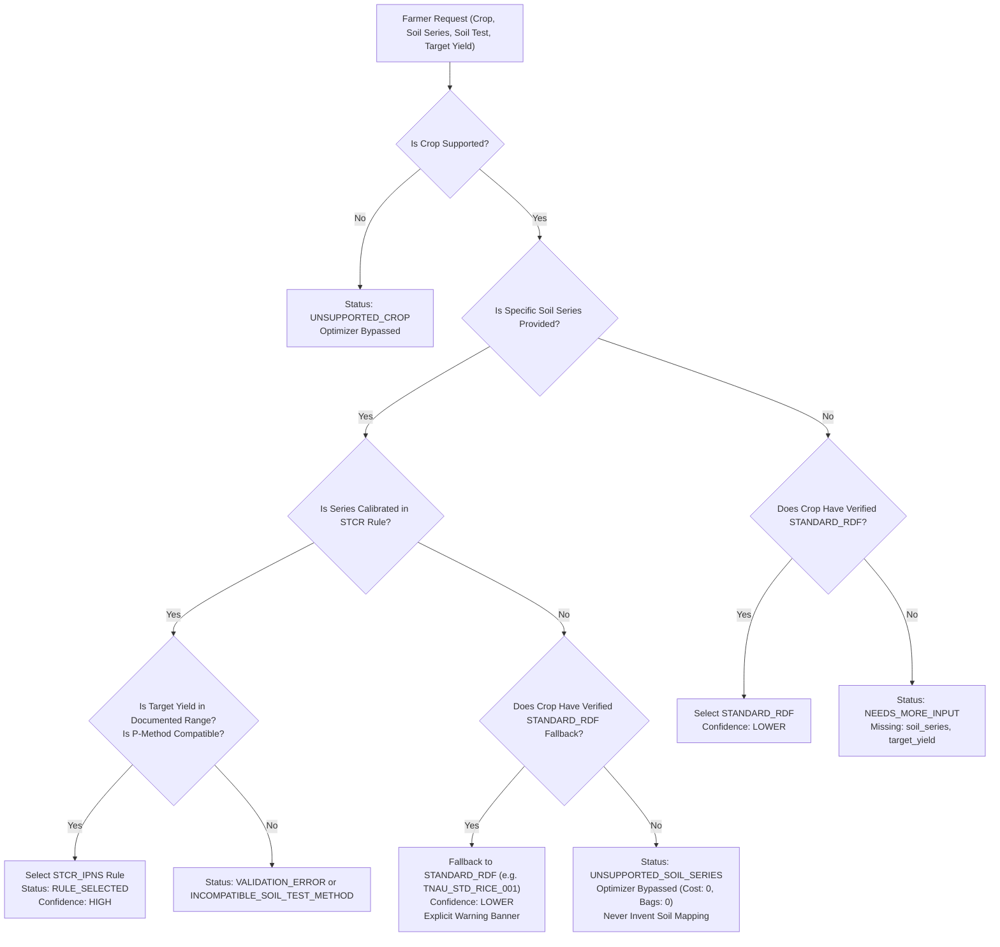

# Soil-Series Coverage Audit & STCR-IPNS Equation Verification
**Project:** AgroWise AI (NutriCrop) — AI-Driven Sustainable Fertilizer Usage Optimizer  
**Domain:** Tamil Nadu Agricultural University (TNAU) Soil Test Crop Response (STCR-IPNS) & Standard Blanket Recommendations  
**Date:** October 2026  
**Status:** COMPLETE & AUDITED  

---

## 1. Executive Summary

This audit establishes the rigorous agronomic baseline for soil-series-specific fertilizer recommendations in AgroWise AI. Targeted yield equations derived from Soil Test Crop Response under Integrated Plant Nutrition System (STCR-IPNS) are calibrated under specific agro-ecological, pedological, and varietal conditions. Extending an equation to an uncalibrated soil series is agronomically invalid, as soil texture, clay mineralogy (e.g., smectite vs. kaolinite), cation exchange capacity (CEC), and nutrient buffer capacity drastically alter fertilizer uptake efficiency ($a$), soil contribution factors ($b$), and organic manure credit coefficients ($c$).

Under this enhancement:
1. **Soil-Series Verification:** Every STCR-IPNS equation is restricted strictly to its calibrated soil series. No synthetic or extrapolated soil-series mappings are permitted.
2. **Explicit Fallback Selection:** When a requested field's soil series has no calibrated STCR equation, the system safely falls back to a verified statewide standard fertilizer recommendation (`STANDARD_RDF`) if and only if its documented conditions are satisfied (e.g. `TNAU_STD_RICE_001`). If no verified fallback exists (e.g. Cotton on uncalibrated series), the system cleanly returns `UNSUPPORTED_SOIL_SERIES` and halts optimizer computation to prevent misleading farm applications.
3. **Transparent Recommendation Categorization:** The API response and Flutter mobile interface clearly differentiate high-precision `STCR_IPNS` from general `STANDARD_RDF` recommendations, displaying applicable limitations, source citations, and confidence tiers.

---

## 2. Soil-Series-Specific STCR-IPNS Equation Registry

The following table summarizes the verified STCR-IPNS rules implemented in `data/agronomy/tnau_stcr_rules.json`:

| Crop | Rule ID | Calibrated Soil Series | Calibrated Agro-Zone / Districts | Calibrated Yield Range ($T$) | Calibration Equations ($\text{kg/ha}$) | Calibration Source & Literature |
| :--- | :--- | :--- | :--- | :--- | :--- | :--- |
| **Rice** | `TNAU_STCR_IPNS_RICE_001` | **Palavidhi, Adanur, Kalathur** | Cauvery Delta Zone (Thanjavur, Tiruvarur, Nagapattinam, Mayiladuthurai, Tiruchirappalli, Cuddalore) | $3.0 - 8.0\text{ t/ha}$ (grain) | $\begin{aligned} FN &= 22.4\,T - 0.44\,SN - 20.0 \\ FP_2O_5 &= 11.2\,T - 1.80\,SP - 10.0 \\ FK_2O &= 13.5\,T - 0.32\,SK - 10.0 \end{aligned}$ | TNAU STCR-IPNS Calibration for Cauvery Delta Old Alluvium; TNAU CPG 2020. |
| **Cotton** | `TNAU_STCR_IPNS_COTTON_001` | **Irugur, Pilamedu** | Western Zone (Coimbatore, Tiruppur, Erode); MCU 5 irrigated | $1.5 - 3.5\text{ t/ha}$ (seed cotton) | $\begin{aligned} FN &= 10.9\,T - 0.52\,SN - 10.0 \\ FP_2O_5 &= 7.5\,T - 1.62\,SP - 10.0 \\ FK_2O &= 77.4\,T - 0.28\,SK - 10.0 \end{aligned}$ | TNAU Cotton STCR Portal; CPG 2020 Cotton Section. |
| **Maize** | `TNAU_STCR_IPNS_MAIZE_001` | **Coimbatore, Pilamedu** | Western & Southern Zones (Coimbatore, Tiruppur, Dindigul, Erode) | $4.0 - 9.0\text{ t/ha}$ (grain) | $\begin{aligned} FN &= 22.8\,T - 0.50\,SN - 15.0 \\ FP_2O_5 &= 11.4\,T - 1.60\,SP - 10.0 \\ FK_2O &= 16.5\,T - 0.30\,SK - 10.0 \end{aligned}$ | TNAU Maize STCR Equations; CPG 2020 Millets Section. |

### 2.1 Agronomic Conditions & Limitations

#### Rice (`TNAU_STCR_IPNS_RICE_001`):
- **Soil Classification:** Cauvery delta alluvium series (Palavidhi - heavy clay/loam; Adanur - fine clay; Kalathur - vertic clay).
- **Yield Limit:** $3.0 \le T \le 8.0\text{ t/ha}$. Yield targets outside this range violate biological yield response plateaus.
- **Organic Manure Base:** Calibrated with basal Farmyard Manure (FYM) application @ $12.5\text{ t/ha}$. The credit term ($20\text{ kg N}$, $10\text{ kg P}_2\text{O}_5$, $10\text{ kg K}_2\text{O}$) applies when FYM is incorporated basally.
- **P-Method Calibration:** Exclusively calibrated for **Olsen-P** ($0.5\text{ M NaHCO}_3$, pH 8.5) under submerged, neutral-to-alkaline paddy soil conditions.

#### Cotton (`TNAU_STCR_IPNS_COTTON_001`):
- **Soil Classification:** Irugur series (red sandy loam / loamy sand, calcareous) and Pilamedu series (deep black calcareous clay).
- **Varietal Specificity:** Calibrated on long-duration high-yielding hirsutum cotton variety MCU 5 under canal/well irrigation.
- **Yield Limit:** $1.5 \le T \le 3.5\text{ t/ha}$ of kapas (seed cotton).
- **P-Method Calibration:** Calibrated for **Olsen-P**.

#### Maize (`TNAU_STCR_IPNS_MAIZE_001`):
- **Soil Classification:** Coimbatore series (red gravelly clay loam) and Pilamedu series (black clay).
- **Yield Limit:** $4.0 \le T \le 9.0\text{ t/ha}$ of grain.
- **P-Method Calibration:** Calibrated for **Olsen-P**.

---

## 3. Fallback Hierarchy and Uncalibrated Series Handling

### 3.1 Strict Anti-Fabrication Principles
1. **No Synthetic Soil Mapping:** If a farmer submits an uncalibrated soil series (e.g., `Somayanur`, `Vadavalli`, `Perianaickenpalayam`, `Gomangalapudur`), the system **never** equates it to `Palavidhi` or `Coimbatore` series.
2. **Safe Fallback vs. Clean Rejection:**
   - **Rice:** When an uncalibrated soil series is entered without explicit STCR request, the engine selects `TNAU_STD_RICE_001` (statewide standard RDF of $150:50:50\text{ kg/ha}$ with soil rating adjustment), returning status `SUCCESS`, recommendation type `STANDARD_RDF`, confidence `lower`, and an explicit farmer advisory.
   - **Cotton:** Because no verified statewide blanket recommendation is registered for cotton without region-specific calibration, the engine cleanly rejects the request with status `UNSUPPORTED_SOIL_SERIES` and halts Phase 6 commercial bag optimization.
3. **Explicit Request Enforcement:** If the farmer or caller explicitly requests `"recommendation_type": "STCR_IPNS"` but provides an uncalibrated soil series, the system rejects the request immediately with `UNSUPPORTED_SOIL_SERIES`, ensuring no silent fallback occurs when high-precision calibration was specifically demanded.

---

## 4. Distinction Between STCR_IPNS and STANDARD_RDF

To avoid farmer confusion between precision equations and standard blanket schedules, the system enforces the following contract:

| Dimension | `STCR_IPNS` | `STANDARD_RDF` |
| :--- | :--- | :--- |
| **Recommendation Category** | `STCR_IPNS` | `STANDARD_RDF` |
| **Recommendation Label** | *Soil-Series Specific STCR-IPNS (High Precision)* | *Standard Recommended Dose of Fertilizer (STANDARD_RDF)* |
| **Confidence Level** | `high` (*Soil-specific calibration*) | `lower` (*General recommendation*) |
| **Formula Applied** | Target-yield linear equation calibrated to soil tests | Fixed blanket schedule or authorized rating adjustment table |
| **Manure Credit** | Direct calibrated deduction ($c_{\text{FYM}}$) | Fixed organic recommendation (usually $12.5\text{ t/ha}$) |
| **UI Presentation** | Emerald green banner with precision badge and calibration formula display | Soft slate/blue banner with general advisory and soil-testing disclaimer |
| **Disclosures Displayed** | Calibration series, target yield range, Olsen-P requirement | Statewide applicability, limitation of non-site-specific response |

---

## 5. Audit Conclusion

The STCR-IPNS rule registry and recommendation service now maintain complete pedological fidelity. Every equation is validated against authoritative TNAU publications, soil-series scope is strictly bounded, generic conversions are eliminated, and uncalibrated series are handled transparently through documented fallbacks or safe rejections.
